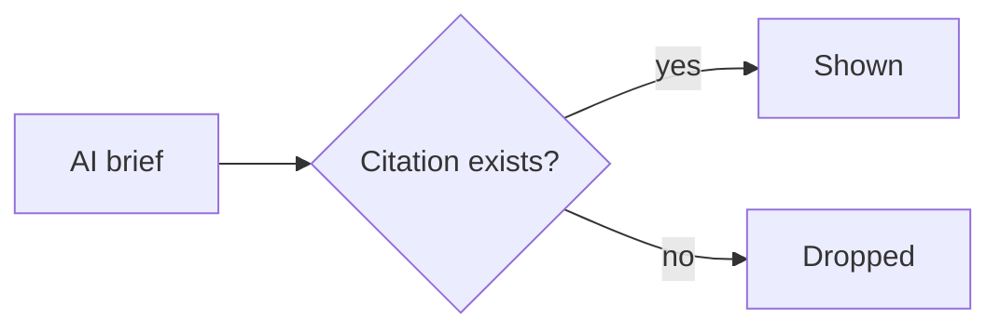

import Callout from "@components/Callout.astro";

{/* prettier-ignore */}
<Callout type="award">
  Renewal Rescue Desk won _1st runner-up_ at the [RELX REPH AI Summit 2026 Hackathon](/posts/reph26-reflections).
</Callout>

Renewal Rescue Desk helps customer success managers (CSMs) see which accounts are about to churn, why, and what to say to them. I led a team of three and handled most of the implementation and data work, all in a five-hour onsite sprint.

## Why we built it

Every team got the same synthetic dataset for a fictional company. We picked the customer support track and its question: which customers might leave?

1,600 of 12,000 customers had churned, taking about $87.7M in yearly revenue with them. The warning signs were there, but split across usage, support cases, and renewals. An account could look fine in each one while heading out the door, and no CSM has time to check all three for every account.

## How it turned out

### A ranked queue

Each account gets a risk score from five simple rules.

| Signal                                              | Points |
| --------------------------------------------------- | ------ |
| Usage down more than 50% (last 3 months vs prior 3) | +5     |
| Usage down more than 25%                            | +3     |
| An escalated case in the last 90 days               | +2     |
| Average CSAT under 3.5 in the last 90 days          | +1     |
| Two or more cases in the last 90 days               | +1     |

Every rule that fires shows up as a plain reason, like "Usage down 62%". The queue sorts by score, then revenue, then renewal date.

### An AI brief with citations

Opening an account shows an AI-written brief: what's going on, the likely reason for churn, suggested next steps, and a draft email.

Every claim in the brief has to cite a real case ID or usage month. Code checks each one and drops anything the model made up. If the AI call fails, a labeled template shows instead.

### Scoring new accounts

Judges could hand us an account we'd never seen. The upload page takes a CSV, JSON, or pasted text, the AI turns it into structured data, the user confirms it, and the same rules score it.

### A human approves everything

Nothing gets sent automatically. The CSM approves, edits, or dismisses every draft, and each decision is logged. There's also a chat assistant that can look up accounts, but it can only suggest a decision, not make one.

### How much to trust it

I ran a backtest on the historical data. The top 100 flagged accounts each month churned at 23%, against a 1.6% average, about 15 times higher. Churners were flagged a median of 38 days before they left.

The catch is that I tuned the rules on that same synthetic data, so the real numbers would likely be lower. The app says this on a reliability page.

## How we built it

### Technologies we used

|                    |                                            |
| ------------------ | ------------------------------------------ |
| **Frontend**       | Next.js + Tailwind CSS + shadcn/ui         |
| **Database**       | SQLite + Drizzle ORM                       |
| **AI Integration** | Vercel AI SDK + Claude on AWS Bedrock      |
| **Data Analysis**  | Python + pandas                            |
| **Deployment**     | Docker on AWS EC2 (provided by organizers) |
| **Dev Tools**      | GitHub Copilot (provided by organizers)    |

### Rules rank, AI explains

The key decision was keeping AI out of the ranking. Rules decide who's at risk, so results are consistent and every flag is explainable. AI handles what rules can't: reading messy files, explaining a risk, and drafting outreach.

```mermaid
flowchart LR
    Data[(Usage, cases, renewals)] --> Rules[Rules rank]
    Rules --> AI[AI explains]
    AI --> CSM[CSM decides]

    style Rules fill:#1f2020
```

The data pushed us this way too. The support messages were mostly copy-pasted stock lines, so the AI leans on structured fields like category and priority instead of message text.

### Agentic coding in five hours

We built most of it with GitHub Copilot, which the organizers provided and encouraged. Before coding, we wrote a PRD and reviewed it as a team, then used it to guide the agent while I reviewed its output.

With so little time, I kept the stack simple: SQLite instead of Postgres, rules instead of a trained model, and cached briefs so the demo never waited on the AI.

## What I learned

I went in thinking of this as churn prediction. It isn't. A 23% hit rate is a weak predictor, but as a way to decide which accounts to check first, it's much better than nothing. Saying that plainly was easier to defend than pretending it was more.

The judges also pointed out that we only designed for managers. The customer, the one about to leave, never sees anything. That's where I'd take it next.
