import Callout from "@components/Callout.astro";
import { Image } from "astro:assets";
import capacityImg from "./screenshots/capacity.png";
import suggestionsImg from "./screenshots/suggestions.png";
import forecastImg from "./screenshots/forecast.png";

{/* prettier-ignore */}
<Callout type="award">
  SACKTO won _Champion_ at [Hack Iloilo 2026](/posts/hackiloilo26-reflections).
</Callout>

SACKTO helps the Iloilo Rice Processing Complex (IRPC) see how much palay is coming, and whether they can handle it. I led a team of five and did most of the implementation over a two-day onsite build.

## Why we built it

IRPC is a government-run facility that dries, stores, and mills palay. Its challenge asked for a broad digital platform, but most of what it described came from one cause. IRPC can't see palay coming until it reaches the gate.

So at harvest, arrivals pile up past what the machines can take, and off-season, the machines sit idle. We built SACKTO around matching supply with capacity, and left anything that didn't help with that for later.

## How it turned out

### Seeing what's coming

The plant manager gets one view of how full the dryers, storage, and mill will be over the next few weeks, based on bookings and a harvest forecast. Busy and empty days stand out right away.

<Image
  src={capacityImg}
  alt="Capacity page showing the dryers, storage, and mill"
  class="w-full"
/>

The forecast shows a likely range instead of a single number, since it's an estimate.

<Image
  src={forecastImg}
  alt="Weekly arrival forecast with likely ranges"
  class="w-full"
/>

### Suggesting what to do

For busy and empty days, SACKTO suggests what staff can do about them, like asking flexible farmers to move or texting prices to farmers who haven't booked. Staff decide, and farmers confirm. Nothing goes out on its own.

<Image
  src={suggestionsImg}
  alt="A suggestion to text prices to farmers during idle days"
  class="w-full"
/>

### Booking by text

Most farmers use basic phones, so they book by plain SMS. They don't always follow a format, so a text like "Pa-dry ko 40 ka sako" goes to an LLM that pulls out what they want. The farmer confirms before anything is booked.

## How we built it

### Technologies we used

|                       |                                    |
| --------------------- | ---------------------------------- |
| **Frontend**          | Next.js + Tailwind CSS + shadcn/ui |
| **Database and Auth** | Supabase (Postgres)                |
| **AI Integration**    | Vercel AI SDK                      |
| **Forecasting**       | Python                             |
| **Deployment**        | Vercel                             |

### Code computes, AI reads

Every number in SACKTO comes from code. The LLM only reads messy texts from farmers, and they confirm what it understood. The suggestions don't come from the model either, so staff never see a figure it made up.

```mermaid
flowchart LR
    SMS[Farmer text] --> LLM[LLM reads]
    LLM --> Farmer[Farmer confirms]
    Farmer --> Code[Code plans]
    Code --> Staff[Staff decide]

    style Code fill:#1f2020
```

## What I learned

Keeping the LLM away from the numbers made SACKTO easy to trust. Everything on screen traces back to a booking or the forecast.

The data was the hard part. Even basic figures were hard to pin down, so the app treats them as settings staff can change instead of hardcoding them.

There's no pilot yet. Until SACKTO runs through a real harvest, it's only as good as the sample data behind it.
